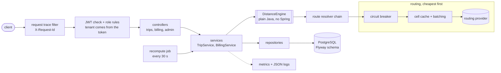
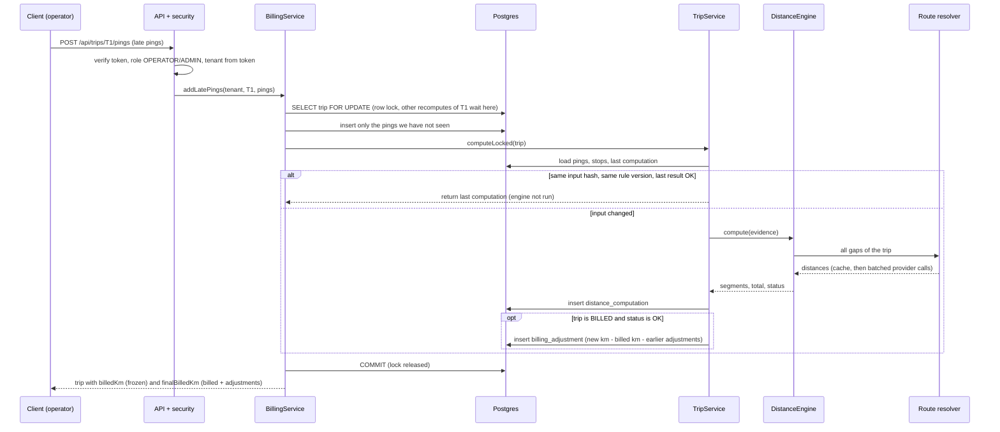

# Design note

The first draft of this file was written before any code (the brief says plan first). This is
the version after building it: what the system actually does, where it breaks, and what I chose
not to do. The README has how to run it and the numbers.

## The problem in one paragraph

Vendors are paid per kilometre and the kilometres come from a GPS box that drops out in tunnels,
sends pings twice, sends them late, or occasionally jumps 9 km for a few seconds. Adding up the
distance between pings under-pays the vendor; asking a maps API to fill every hole over-pays and
costs a lot of calls. So the system rebuilds a distance per trip from pings plus the places we
know the cab must have been (anchors), prices each stretch with a fixed, versioned set of rules,
and labels every stretch with the rule that priced it so a dispute can be answered line by line.

## Architecture



Layers, top to bottom, and the rule each one keeps:

| Layer | Package | What it must not do |
|---|---|---|
| web | `web` | no business rules: it turns HTTP into a service call and back |
| security | `security` | never read the tenant from the request body, only from the verified token |
| service | `service` | no distance maths: it stores, locks, hashes and calls the engine |
| engine | `engine.*` | no Spring, no database, and the distance maths never reads the time or the network: same input and same config give the same output (the routing answer is the one outside input; the circuit breaker takes its clock as a parameter so tests can move time) |
| persistence | `persistence` | every lookup carries the tenant id |

The engine being plain Java is what makes the hard rules testable without a server: most of the
~240 tests never start Spring.

## How one trip is processed

1. **Clean the pings**: drop pings outside the trip window, with impossible coordinates or poor
   accuracy; sort; drop duplicates (same timestamp, best accuracy wins); drop teleports (speed
   from the last accepted ping above 120 km/h).
2. **Build anchors**: each employee's pickup/drop (falling back to home + sign-in time, or the
   planned spot + time), no-shows behind a flag, and the office (actual end point if within 400 m
   of the planned office, otherwise the planned office at the trip end).
3. **Merge** pings and anchors into one ordered track.
4. **Price each neighbouring pair**, always in this order: under 70 s at a believable speed is
   `SHORT_GAP_AERIAL`; 70 s or more below 5 km/h is `PARKED`; anything else needs a route.
5. **Resolve all routes of the trip at once**: dedupe, look in the cache, send the rest in
   batches of 25, behind the circuit breaker. Accept or reject each answer (`ROUTED`,
   `REJECTED_DISTANCE`, `REJECTED_SPEED`).
6. **If routing is unavailable**: bill straight line x 1.4 for those gaps (`DEGRADED_ESTIMATE`)
   and mark the trip `DEGRADED`.
7. **Add up** whole millimetres, round to km once (half-up, 2 decimals).

The rule order and every threshold are part of a rule version string (`v1-` plus a hash of the
thresholds), stored with each result.

## Data model

All tables carry `tenant_id`. `distance_computation` rows are only ever added: each one keeps the
input hash, rule version, the answer, what routing cost, and every segment as JSON (rider home
coordinates are left out of that JSON).

```
trip ──< trip_stop
  │ ──< ping            (unique per trip + time + position, so a repeat is stored once)
  │ ──< distance_computation
  └──< billing_adjustment   (unique per computation: one change, one adjustment)
app_user  (bcrypt hash, role, tenant)
```

## The hardest flow: late pings on a billed trip

This is where the money rules meet concurrency, so it is the one I drew out.



Two properties fall out of this shape:
- A closed invoice is never edited. `billedKm` is frozen when the invoice closes; later changes
  are signed rows (`+1.80`, `-0.40`) and `finalBilledKm` is the sum.
- Sending the same late pings twice, or twelve times at once, produces one computation and one
  adjustment: the second caller waits for the lock, finds the pings already there, hashes the same
  input, and returns the existing result. There is a test for exactly that.

## Failure modes

| What fails | What the caller sees | How it recovers |
|---|---|---|
| Routing provider down or erroring | Trip comes back `DEGRADED` with straight line x 1.4 for the gaps; billing it is refused with 409 | Circuit opens after 5 failures and stops calling; recompute job retries every 30 s (skipped while the circuit is open); first healthy probe closes the circuit; degraded trips are recomputed and match a no-outage run exactly |
| Provider returns nonsense (over 100 km, impossible speed) | Segment labelled `REJECTED_DISTANCE` / `REJECTED_SPEED`, billed 0, numbers kept in the output | None needed; visible in the segments and the rejection counters |
| Duplicate, shuffled or out-of-window pings | Same answer as a clean stream | Cleaner dedupes, sorts and drops them; counted by reason in metrics |
| Bad GPS fix or burst (9 km for 4 s) | Distance unchanged | Teleport filter compares with the last accepted ping |
| Late pings after billing | `finalBilledKm` moves by a signed delta; `billedKm` does not | Adjustment row, one per computation |
| Two recomputes of one trip at once, even on two servers | One result | Row lock on the trip; the second finds the work done |
| Same trip submitted twice | The first result again, no second computation | Idempotent per tenant + trip ref |
| Instance dies mid-computation | Request fails; nothing partial is saved | Transaction rolls back, lock is released; the client retries and the idempotent path takes over |
| Database unavailable | 500 `INTERNAL_ERROR` with a trace id | Client retries; no half-written state exists |
| Expired, forged or wrong-issuer token | 401, same body for every reason | Log in again |
| Wrong role / other tenant's trip | 403 / 404 (404 for another tenant, so existence is not revealed) | n/a |
| Cache holds an outdated road distance | Same km as before for an unchanged trip | See "What can go stale" below |

## Complexity and where it stops scaling

For one trip with n pings, k employee stops and g real gaps:

| Step | Time | Memory |
|---|---|---|
| clean (sort + one pass) | O(n log n) | O(n) |
| anchors | O(k) | O(k) |
| merge + sort | O((n + k) log (n + k)) | O(n + k) |
| price segments | O(n + k) | O(n + k) |
| route resolution | O(g log g) (sort for stable batches) | O(g) |

Across trips nothing is shared except the route cache (bounded: 100,000 entries). Measured, not
estimated, over repeated runs of the 10,000-trip benchmark: about 1 ms median and 2 ms p99 per
1,500-ping trip on one core, roughly 700-1,000 trips/s per thread and about 6,600-6,900 trips/s on
16 threads. Peak heap lands anywhere from about 120 MB to about 860 MB: it is sampled while the
run is going, so it includes garbage the collector has not got to yet. The README has the table
and the machine; treat all of these as "about", since they move 10-15% between runs.

Where it stops, in the order I expect it to bite:
1. **The database, not the engine.** A trip's computation holds a row lock and a transaction while
   it runs, and the routing call happens inside that transaction. With a slow real provider, a
   trip is locked for as long as the provider takes, and the connection pool (not the CPU) caps
   throughput. First fix: resolve routes before opening the write transaction.
2. **Ping volume.** Every ping is a row with a unique index; ingesting 1,500 per trip is fine,
   hundreds of millions need partitioning by month or moving pings out of the relational store.
3. **Per-instance state.** The route cache and circuit breaker live in each instance. With N
   instances the cache warms N times and each breaker trips on its own. Fix: shared cache (Redis)
   and a shared breaker state.
4. **The recovery job** moves 100 trips per run, so a long outage drains at roughly 200 trips a
   minute per instance; fine for thousands, slow for millions.
5. **One enormous trip** (millions of pings) is a single O(n log n) sort and one big row set; the
   fix is to chunk the trip by time.

## Trade-offs

**Consistency over availability for money, availability over consistency for estimates.**
- A `DEGRADED` trip is returned immediately (available) but cannot be billed (consistent). The
  vendor sees a number straight away; nothing wrong can be invoiced.
- Billed amounts are never rewritten, only adjusted (audit trail beats a tidy number).

**Latency vs cost.** Routes are always asked about grid-cell centres (~110 m cells). That makes a
cache hit and a miss give identical numbers, so caching can never change a bill, and it cuts
provider calls by more than 99% in the benchmark. The price is up to about 150 m of position
error on a routed gap, which matters proportionally more on short gaps than long ones.

**Per-trip serialisation vs throughput.** One row lock per trip makes concurrent recomputes safe
and simple to reason about, at the cost of making writers of the same trip queue.

**Rejected segments bill 0.** If even a generous detour cannot explain the speed, one of the two
points is wrong, so we do not pay for the jump; the segment stays visible with its numbers.

**Synchronous API.** Ingest returns the computed result in the same call. Simple and testable;
the price is request time proportional to the trip, and no buffering if traffic spikes.

### What can go stale, and for how long
- **Cached route distances**: up to 24 hours (the cache TTL) behind the real road network. They
  are keyed on the cell pair, not the trip, so one stale route affects every trip using it.
- **What bounds the damage**: an unchanged trip with an OK result is never recomputed, so a
  billed number does not drift when the cache expires. A recompute only happens when the input or
  the rule version changes, and then any difference is booked as an explicit adjustment.
- **Rule version**: a result keeps the version it was computed under. Changing a threshold
  changes the version; nothing is silently re-billed, and the stored version says which rules
  produced a number.

## Deliberately left out

- **A real maps provider.** There is a simulated one (deterministic detour factor 1.25-1.45,
  switchable outage, counted calls) behind the same interface a real one would use.
- **Provider timeouts and retries.** The circuit breaker counts failures, but there is no
  per-call timeout or retry with backoff; a real HTTP client needs both.
- **A message broker.** Ingest is a synchronous request; the recovery queue is a database status.
- **Shared cache / shared breaker**, **per-tenant rule configuration**, **re-billing on a rule
  version change**, **refresh tokens and user management**, **rate limiting on login**,
  **invoice documents**, **a UI**.
- **Real accounts.** The demo accounts are created at start-up for trying the API and are turned
  off with `SEED_DEMO_USERS=false`.
